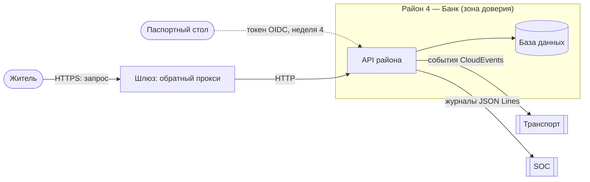

# Архитектура района 4 — Банк

**Команда:** <4> · **Тимлид:** <Павлов Кирилл Максимович> · **Версия:** v0 · **Дата:** <13.10.26>

## 1. Назначение
<Что делает район для города — 2–3 предложения.>

## 2. Политика безопасности
<2–3 предложения: что разрешено, что запрещено, кто за что отвечает. Пример формы:
«Изменять X может только роль Y и только через Z; каждое изменение записывается в журнал».>

## 3. Компоненты
| Компонент (сервис Compose) | Что делает | Технология | Порт внутри района | Виден другим районам? |
|---|---|---|---|---|
| api | Обрабатывает запросы пользователей и предоставляет API района | Приложение API | 8080 | С хоста через 127.0.0.1:8080 |
| db | Хранит данные района и обрабатывает запросы к базе данных | PostgreSQL | 5432 | Только внутри сети Docker |

## 4. Схема потоков данных (DFD)
Обозначения: `user([Житель])` — внешняя сущность, `api[API района]` — процесс, `db[(База данных)]` — хранилище,
стрелка — поток данных (подпишите, что передаётся и по какому протоколу),
`subgraph` — зона доверия (граница доверия — край подграфа).

## 5. Границы доверия
| № | Граница | Что по разные стороны | Как контролируется сейчас | Как будет (неделя) |
|---|---|---|---|---|
| Г1 | Шлюз → API района | город / район | пока никак | TLS (3), SSO (4) |
| Г2 | API района → База Данных | Внутренняя сеть Docker Compose / хранилище данных |  |

## 6. Внешние зависимости
| От кого зависим | Что получаем | Что будет, если он недоступен или скомпрометирован |
|---|---|---|
| Паспортный стол | вход пользователей, сертификаты | |
| Транспорт | доставка событий | |
| SOC | приём журналов | |

## 7. Соответствие соглашениям города
- [ ] Имена по Р1 (`d4-bank`, `*.bank.city.lab`)
- [ ] Время UTC (Р3)
- [ ] Журналы JSON Lines с обязательными полями (Р4)
- [ ] События в конверте CloudEvents (Р5), описаны в `contracts/events.md`
- [ ] API описан в `contracts/openapi.yaml`, есть `/health` (Р6)
- [ ] Секретов в Git нет (Р7)
