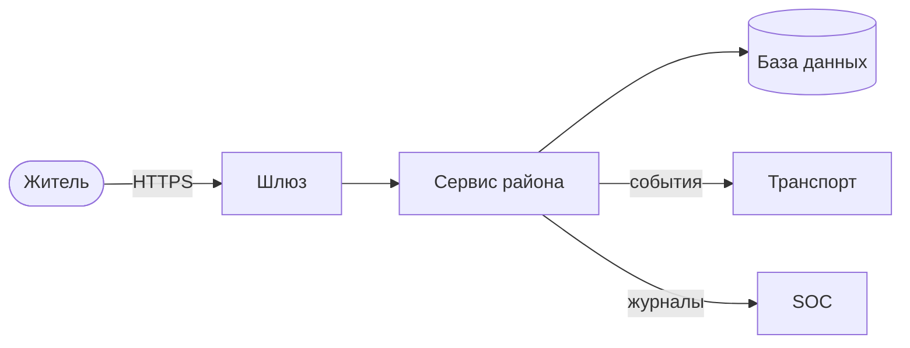

# Модель угроз района

> **Как пользоваться.** Версия v0 — к концу недели 2, v1 — к неделе 6. Понятия: Модель угроз, STRIDE, Модель нарушителя, Политика безопасности. Систему рассматриваем на уровне 6 — вместе с людьми (см. выжимку глав 1–2). Порядок работы — в «ЛР1. Архитектура района и модель угроз v0»; образец — «Городская библиотека»..

**Район:** 4 — Банк · **Команда:** <4> · **Версия:** v0 · **Дата:** <18.10.26> · **Авторы:** <Шляпников Максим Сергеевич>

## 1. Политика безопасности района
<2–3 предложения: что разрешено, что запрещено, кто за что отвечает.>

## 2. Активы — что защищаем
| Актив | Где хранится / проходит | Что важнее: конфиденциальность, целостность, доступность | Почему ценен |
|---|---|---|---|
| | | | |

## 2а. Что есть у атакующего (активы атакующего)
С чего противник может начать: что ему доступно легально или по сценарию игры.
| Возможность атакующего | Откуда она у него | Куда может привести |
|---|---|---|
| <учётная запись жителя> | регистрация в Паспортном столе | <...> |
| <открытый код и документация района> | режим white-box | <...> |

## 3. Участники и роли
| Роль / принципал | Что может делать | Как аутентифицируется |
|---|---|---|
| <житель> | | <SSO Паспортного стола> |
| <администратор района> | | |
| <сервис другого района> | | <mTLS-сертификат> |

## 4. Схема потоков данных (DFD)
Опишите или вставьте схему: внешние участники, процессы (сервисы), хранилища данных, потоки между ними.



## 5. Границы доверия
| Граница | Что по разные стороны | Как контролируется |
|---|---|---|
| | | |

## 6. Модель нарушителя
| Противник | Возможности | Мотив | Вероятность для нас |
|---|---|---|---|
| | | | высокая / средняя / низкая |

## 7. Угрозы по STRIDE
Для каждого элемента DFD пройдите шесть классов угроз. Если класс неприменим — так и напишите.

| Элемент | S — подмена | T — изменение | R — отказ от авторства | I — утечка | D — отказ в обслуживании | E — повышение привилегий |
|---|---|---|---|---|---|---|
| | | | | | | |

### Реестр угроз
Каждая угроза — отдельная строка. Риск = вероятность (1–5) × ущерб (1–5).
| ID | Элемент DFD | STRIDE | Угроза: кто, что делает, к чему приводит | Вероятность | Ущерб | Риск | Мера (раздел 9) |
|---|---|---|---|---|---|---|---|
| T01 | API района | D | Атакующий отправляет большое количество запросов, из-за чего API перестаёт отвечать | 4 | 4 | 16 | Ограничение частоты запросов, тайм-ауты |
| T02 | База данных | D | Большое количество тяжёлых запросов исчерпывает ресурсы БД и мешает обработке запросов | 3 | 4 | 12 | Ограничение времени запросов и числа соединений |
| T03 | Журналы | D |  Быстрое накопление журналов заполняет диск, из-за чего сервисы перестают работать | 3 | 4 | 12 | Ротация журналов, ограничение объёма и контроль свободного места |
| T04 | API района / База данных | D | База данных становится недоступна, и API не может обрабатывать запросы | 3 | 5 | 15 | Тайм-ауты подключения и проверка доступности БД |

## 8. Дерево атаки (для самой ценной цели)
```
Цель: <...>
├── ИЛИ: <путь 1>
├── ИЛИ: <путь 2>
└── ИЛИ: <путь 3>
```

## 9. Меры защиты
| Угроза | Мера | Кто отвечает | Статус |
|---|---|---|---|
| T01 | Ограничение частоты запросов и тайм-ауты | Инженер инфраструктуры | план |
| T02 | Ограничение времени запросов и числа соединений с БД | Разработчик | план |
| T03 | Ротация журналов и контроль свободного места | Инженер инфраструктуры | план |
| T04 | Тайм-ауты подключения и проверка доступности БД | Разработчик | план |


## 10. Остаточные риски
<Что сознательно не закрываем и почему.>

## 11. Использование LLM
<Что генерировали с помощью модели, что исправили. Запись — в Журнал использования LLM.>

## История версий
| Версия | Дата | Что изменилось |
|---|---|---|
| v0 | | первая версия (неделя 2) |
