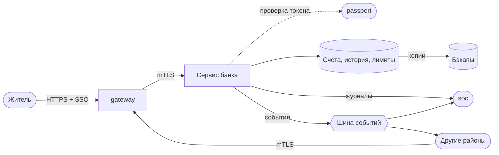

# Модель угроз района

> **Как пользоваться.** Версия v0 — к концу недели 2, v1 — к неделе 6. Понятия: Модель угроз, STRIDE, Модель нарушителя, Политика безопасности. Систему рассматриваем на уровне 6 — вместе с людьми (см. выжимку глав 1–2). Порядок работы — в «ЛР1. Архитектура района и модель угроз v0»; образец — «Городская библиотека»..

**Район:** Банк · **Команда:** 4 · **Версия:** v0 · **Дата:** 18.10.26 · **Авторы:** Шляпников Максим Сергеевич; Павлов Кирилл Максимович

## 1. Политика безопасности района
Распоряжаться средствами на счёте (переводить, снимать, закрывать счёт) может только его владелец, прошедший аутентификацию, и только в пределах собственного счёта; операции свыше установленного лимита подтверждаются вторым фактором. Менять остатки, тарифы и реквизиты счетов напрямую может только сотрудник банка с ролью «операционист» по запросу клиента, а правила и лимиты для всего района задаёт только администратор; никто, включая операциониста, не может одновременно инициировать и утверждать одну и ту же операцию. Любая операция со счётом, вход в систему и изменение настроек записываются в журнал, который нельзя править задним числом, и отправляются в SOC.

## 2. Активы — что защищаем
| № | Актив | Где хранится / проходит | Что важнее | Почему |
|---|-------|-------------------------|------------|--------|
| A1 | Счета и остатки жителей и организаций | БД банка | **Целостность** | Подмена остатка = прямой денежный ущерб; потерю или утечку можно восстановить/ограничить, а неверную цифру трудно заметить |
| A2 | История операций (переводы, снятия, пополнения) | БД банка; копия в `soc` | **Целостность** | Основа для сверки и расследований; изменение задним числом ломает доверие ко всему району |
| A3 | Платёжный API (переводы, снятие, закрытие счёта) | Сервис банка; вход через `gateway` | **Доступность** | Через него платят `hospital`, `transport`, `cityhall` и другие; простой останавливает расчёты по городу |
| A4 | Журнал аудита и поток событий в SOC | Локальный журнал банка; шина событий → `soc` | **Целостность** | Единственный способ увидеть атаку; если журнал можно править или заглушить, атака невидима |
| A5 | Учётные записи сотрудников и администратора банка | БД учётных записей; сессии, интеграция с `passport` | **Конфиденциальность** | Учётка администратора позволяет менять лимиты и правила, а операциониста — остатки |
| A6 | Ключи, сертификаты и файл `.env` (пароли БД, токены межрайонного API, ключ подписи операций) | Конфигурация сервиса, переменные окружения | **Конфиденциальность** | Утечка даёт доступ «как у банка» без взлома логики; ключ подписи позволяет подделывать операции |
| A7 | Резервные копии БД | Хранилище бэкапов банка | **Конфиденциальность** (и целостность) | В копии те же данные, что в БД, но защита обычно слабее; подменённая копия отравит восстановление |
| A8 | Персональные данные клиентов (ФИО, идентификаторы, реквизиты) | БД банка; идентификаторы приходят из `passport` | **Конфиденциальность** | Утечка необратима и бьёт по репутации |
| A9 | Репутация и доверие жителей к банку | Не хранится, складывается из всего выше | **Целостность** | Один случай неверного списания подрывает доверие ко всей платёжной системе города |
| A10 | Лимиты и правила операций (пороги, тарифы, второй фактор) | Конфигурация банка | **Целостность** | Подмена порога открывает путь к крупным переводам без подтверждения |

## 2а. Что есть у атакующего (активы атакующего)
| № | Возможности атакующего | Откуда берётся | С чего он может начать |
|---|------------------|----------------|------------------------|
| B1 | Обычная учётная запись жителя (через `passport`) | Любой может зарегистрироваться | Легитимный вход в платёжный API; перебор прав, обращение к чужому счёту (IDOR), обход лимитов |
| B2 | Открытый код и документация всех районов (режим white box) | Репозиторий | Знание форматов сообщений, эндпоинтов, слабых мест в логике банка и соседей |
| B3 | Доступ к шине событий как у любого района | Общая инфраструктура города | Подделка или подслушивание событий, ложные события «от имени» другого района, заглушение событий для SOC |
| B4 | Учётная запись рядового сотрудника (инсайдерская карта, раунд 3) | Подкуп, фишинг, роль в раунде | Доступ к функциям операциониста; попытка обойти правило «инициатор ≠ утверждающий» |
| B5 | Скомпрометированный соседний район (например, `hospital` или `transport`) | Взлом более слабого района | Доверенные межрайонные вызовы к банку: запросы списания «от имени» района |
| B6 | Входной трафик через `gateway` | Публичная точка входа | Fuzzing, перегрузка, попытки обойти проверки `gateway` и обратиться к банку напрямую |

### Связь с соседними районами

- `gateway` защищает вход в A3.
- `passport` выдаёт идентичности для A5, A8 и B1.
- `soc` принимает A4.
- `cityhall`, `hospital`, `transport`, `grid` используют платёжный API (A3) и могут стать вектором B5.

## 3. Участники и роли
| Роль / принципал | Что может делать | Как аутентифицируется |
|---|---|---|
| Житель (клиент) | Открывать и закрывать свой счёт, смотреть остаток и историю, переводить и снимать средства только со своего счёта в пределах лимита; операции свыше лимита подтверждает вторым фактором | SSO Паспортного стола (`passport`), второй фактор для крупных операций |
| Сотрудник банка (операционист) | Выполнять операции по запросу клиента, исправлять реквизиты счёта; не может одновременно инициировать и утверждать одну операцию, не может менять лимиты и правила | Учётная запись сотрудника через `passport`, роль «операционист», второй фактор |
| Администратор района | Задавать лимиты, тарифы и правила, управлять ролями сотрудников, ключами и конфигурацией; не проводит операции по счетам клиентов | Учётная запись администратора через `passport`, обязательный второй фактор, отдельная от рабочей учётка |
| Сервис другого района (`cityhall`, `hospital`, `transport`, `grid`) | Вызывать платёжный API: запросить списание или зачисление в рамках своих договорных операций; не читает чужие счета и историю | mTLS-сертификат района, запрос идёт через `gateway` |
| Сервис `gateway` | Пропускать внешние запросы к API банка после проверки; не меняет данные счетов | mTLS-сертификат `gateway` |
| Сервис `soc` | Читать журнал и поток событий банка, получать оповещения; не меняет данные и конфигурацию | mTLS-сертификат `soc`, доступ только на чтение |

## 4. Схема потоков данных (DFD)
Опишите или вставьте схему: внешние участники, процессы (сервисы), хранилища данных, потоки между ними.



## 5. Границы доверия
| Граница | Что по разные стороны | Как контролируется |
|---|---|---|
| Г1 | Шлюз → API | город / район | пока никак | TLS (3), SSO (4) |
| Г2 | API → База Данных | сервисы / хранилище данных | пока никак | Ограничение доступа к БД и разграничение прав |
| Г3 | API → Транспорт | район / шина событий | пока никак | Подпись событий и защита от повторной отправки |
| Г4 | API → SOC | Район / город | пока никак | Защищённая передача журналов и контроль их целостности |
| Г5 | Паспортный стол → API | город / район | пока никак | SSO через OIDC |

## 6. Модель нарушителя
| Противник | Возможности | Мотив | Вероятность для нас |
|---|---|---|---|
| Недобросовестный клиент банка | Своя учётная запись, браузер, знание API | Получить доступ к чужим банковским данным или обойти ограничения | высокая |
| Внешний злоумышленник | Доступ к шлюзу, инструменты для отправки запросов и анализа API | Получить персональные данные или нарушить работу банка | высокая |
| Нечестный сотрудник банка (инсайдер) | Доступ к внутренним сервисам и данным в пределах своей роли | Просматривать данные клиентов, изменять записи или скрывать операции | средняя |
| Атакующий из другого района | Возможность взаимодействовать с городской шиной событий и отправлять запросы к доступным сервисам | Подделать финансовые события или передать ложные сведения | средняя |
| Любопытный администратор | Административный доступ к инфраструктуре или базе данных | Получить доступ к персональным данным и истории операций клиентов | низкая |

## 7. Угрозы по STRIDE
Для каждого элемента DFD пройдите шесть классов угроз. Если класс неприменим — так и напишите.

| Элемент | S — подмена | T — изменение | R — отказ от авторства | I — утечка | D — отказ в обслуживании | E — повышение привилегий |
|---|---|---|---|---|---|---|
| Житель | T05 — подмена пользователя | - | - | - | - | - |
| Шлюз | T05 — подмена источника запроса | T06 — изменение запроса | - | T08 — раскрытие данных через API | T01 — перегрузка API | - |
| API района | T05 — подмена пользователя | T06 — изменение параметров запроса | T07 — отрицание операции | T08 — выдача чужих данных | T01 — перегрузка API | T09 — обход проверки прав |
| База данных | - | T10 — изменение записей | - | T11 — чтение данных без разрешения | T02, T04 — исчерпание ресурсов и недоступность БД | T09 — избыточные привилегии |
| Журналы / SOC | - | T12 — изменение или удаление журналов | T12 — отрицание действий из-за отсутствия записей | T16 — раскрытие секретов в журналах или конфигурации | T03 — переполнение диска | - |
| Паспортный стол → API | T15 — поддельный токен | - | - | T16 — раскрытие секрета доступа | - | T09 — получение доступа с чужими правами |
| API → Транспорт | - | T13 — подмена события | - | T14 — чтение данных событий | - | - |


### Реестр угроз
Каждая угроза — отдельная строка. Риск = вероятность (1–5) × ущерб (1–5).
| ID | Элемент DFD | STRIDE | Угроза: кто, что делает, к чему приводит | Вероятность | Ущерб | Риск | Почему выбрана такая оценка | Защищает HTTPS |
|---|---|---|---|---|---|---|---|---|
| T01 | API района | D | Атакующий отправляет большое количество запросов, из-за чего API перестаёт отвечать | 4 | 4 | 16 | Массовые запросы легко автоматизировать, а перегрузка API может сделать банковские операции недоступными | Нет |
| T02 | База данных | D | Большое количество тяжёлых запросов исчерпывает ресурсы БД и мешает обработке запросов | 3 | 4 | 12 | Тяжёлые запросы способны исчерпать ресурсы БД, хотя их воздействие можно снизить ограничением времени выполнения и числа соединений | Нет |
| T03 | Журналы | D |  Быстрое накопление журналов заполняет диск, из-за чего сервисы перестают работать | 3 | 4 | 12 | Журналы могут быстро заполнить диск при большом количестве событий, что способно нарушить работу сервисов | Нет |
| T04 | API района / База данных | D | База данных становится недоступна, и API не может обрабатывать запросы | 3 | 5 | 15 | Недоступность БД полностью блокирует зависящие от неё операции API и может затронуть основные функции района | Нет |
| T05 | Житель → Шлюз → API района | S | Злоумышленник выдаёт себя за другого жителя и отправляет запрос от его имени, из-за чего может получить доступ к чужим банковским данным | 3 | 5 | 15 | Подмена личности возможна при недостатках аутентификации и может открыть доступ к чужим финансовым данным | Нет |
| T06 | Шлюз → API района | T | Злоумышленник изменяет параметры запроса, из-за чего API выполняет операцию с данными, отличающимися от первоначального запроса | 3 | 4 | 12 | Изменение параметров запроса возможно при недостаточной защите канала или проверке данных и способно привести к некорректной операции | Да |
| T07 | API района | R | Пользователь отрицает выполнение финансовой операции, а отсутствие достаточных журналов не позволяет установить, кто и когда её инициировал | 3 | 4 | 12 | Без надёжного аудита сложно доказать факт и автора операции, что затрудняет расследование финансовых инцидентов | Нет |
| T08 | API района | I | Злоумышленник запрашивает данные чужого счёта, а API возвращает их без проверки прав доступа | 3 | 5 | 15 | Ошибка проверки прав доступа может раскрыть чужие финансовые данные, последствия чего значительны для конфиденциальности | Нет |
| T09 | API района / База данных | E | Пользователь с обычными правами вызывает административный метод или использует избыточные права учётной записи приложения, получая доступ к недоступным операциям | 3 | 5 | 15 | Ошибки в проверке ролей или избыточные привилегии могут позволить обычному пользователю выполнять критические административные действия | Нет |
| T10 | База данных | T | Злоумышленник с доступом к учётной записи приложения изменяет записи о счетах, из-за чего данные становятся недостоверными | 2 | 5 | 10 | Доступ к учётной записи приложения должен быть ограничен, однако изменение банковских записей может привести к серьёзным финансовым последствиям | Нет |
| T11 | База данных | I | Злоумышленник получает доступ к резервной копии БД и читает персональные и финансовые данные клиентов | 2 | 5 | 10 | Резервные копии обычно доступны ограниченному кругу лиц, но их утечка может раскрыть большой объём персональных и финансовых данных | Нет |
| T12 | Журналы / SOC | T/R | Злоумышленник изменяет или удаляет записи о действиях, из-за чего расследование инцидента становится неполным и его действия сложнее установить | 3 | 4 | 12 | При наличии доступа к журналам злоумышленник может попытаться скрыть следы действий, из-за чего расследование станет менее надёжным | Нет |
| T13 | API → Транспорт | T | Злоумышленник с доступом к транспорту подменяет событие о финансовой операции, из-за чего другой сервис обрабатывает ложные сведения | 2 | 5 | 10 | Для подмены события требуется доступ к транспорту или его учётным данным, но успешная атака может повлиять на обработку финансовых операций | Нет |
| T14 | API → Транспорт | I | Злоумышленник получает доступ к сообщениям транспорта и читает содержащиеся в них персональные или финансовые данные | 2 | 4 | 8 | Доступ к транспорту должен быть ограничен, однако раскрытие сообщений может привести к утечке персональных или финансовых сведений | Нет |
| T15 | Паспортный стол → API | S | Злоумышленник отправляет поддельный токен идентификации, а API принимает его и предоставляет доступ от имени другого пользователя | 3 | 5 | 15 | Поддельный токен может быть принят при ошибках его проверки, что создаёт риск несанкционированного доступа к данным пользователя | Нет |
| T16 | Репозиторий Git / конфигурация API | I | Разработчик случайно публикует пароль или ключ доступа в репозитории, после чего злоумышленник использует секрет для подключения к внутренним сервисам | 2 | 5 | 10 | Публикация секрета в репозитории возможна из-за человеческой ошибки, а его использование может открыть доступ к внутренним сервисам | Нет |
| T17 | API перевода | T | Клиент передаёт сумму перевода ≤ 0; если API принимает её, логика изменения балансов может привести к некорректному движению денег | 3 | 5 | 15 | Недостаточная проверка суммы может позволить некорректную финансовую операцию и нарушить целостность балансов | Нет |
| T18 | API перевода | T/R | Клиент повторяет запрос после тайм-аута; без идемпотентности один перевод может быть выполнен несколько раз | 4 | 5 | 20 | Повторные запросы после тайм-аутов — реалистичный сценарий, а повторное выполнение перевода может привести к двойному списанию денег | Нет |
| T19 | API перевода | S/E | Пользователь указывает в запросе чужой счёт отправителя; при отсутствии проверки владения счётом перевод может пройти без полномочий | 3 | 5 | 15 | Для атаки требуется ошибка проверки принадлежности счёта, но её эксплуатация может привести к несанкционированному переводу средств | Нет |
| T20 | База данных | T/R | Администратор БД напрямую изменяет баланс, обходя прикладной журнал аудита; изменение может остаться незамеченным | 2 | 5 | 10 | Прямой доступ администратора к БД должен быть ограничен, однако скрытое изменение баланса может привести к критическим финансовым последствиям | Нет |
| T21 | Транспорт | T/R | Событие fee.requested доставляется повторно и запускает повторное списание, если обработчик не дедуплицирует события | 3 | 5 | 15 | Повторная доставка сообщений возможна в событийных системах, а отсутствие дедупликации может вызвать повторное списание средств | Нет |
| T22 | Хранилище ключей / TLS-прокси | S |	Злоумышленник получает закрытый ключ district.key и использует его для выдачи себя за район «Банк», что позволяет организовать подмену сервера при определённых условиях | 2 | 5 | 10 | Закрытый ключ должен быть недоступен посторонним, поэтому вероятность компрометации ограничена, однако последствия могут включать подмену сервера и перехват данных | Нет |
| T23 | TLS-прокси / сертификат сервера | D |	Сертификат сервера истекает, из-за чего клиенты, корректно проверяющие сертификаты, отклоняют HTTPS-соединение и не могут пользоваться сервисом | 2 | 4 | 8 | Срок действия сертификата известен заранее, поэтому вероятность можно снизить контролем срока, но пропуск обновления нарушит доступность HTTPS-сервиса | Нет |
| T24	| Клиент / TLS-соединение | S | Клиент отключает проверку сертификата и подключается к поддельному серверу, что создаёт возможность перехвата или изменения передаваемых данных | 3 | 5 | 15 | Ошибочная настройка клиента возможна, а при успешной подмене сервера последствия могут затронуть конфиденциальность и целостность данных | Нет |

### Повтор
В районе «Банк» повтор запросов опасен прежде всего для денежных переводов и получения банковской выписки.
Перевод: повтор запроса может привести к двойному списанию. Защита — уникальный идентификатор операции (Idempotency-Key) и журнал обработанных операций.
Получение выписки: повтор запроса может привести к повторной выдаче конфиденциальных данных. При каждом запросе необходимо проверять права доступа; для защиты от повторов можно использовать уникальный идентификатор запроса и временное окно.
Межрайонные события: повтор события о списании может запустить операцию ещё раз. Защита — уникальный id события, журнал обработанных идентификаторов и проверка времени события.
Проверка идентификатора и выполнение финансовой операции должны быть согласованы, чтобы одновременные повторы не приводили к двойному списанию. HTTPS защищает данные при передаче, но сам по себе не предотвращает повторную отправку ранее полученного корректного запроса.

## 8. Дерево атаки (для самой ценной цели)
```
**Цель: Перевести чужие деньги себе**
├── **ИЛИ: Получить доступ к чужому счёту**
│   ├── ИЛИ: Подменить пользователя или токен (T05, T15)
│   ├── ИЛИ: Использовать ошибку проверки прав доступа (T08, T09)
│   └── ИЛИ: Получить секрет из репозитория Git (T16)
│
├── **ИЛИ: Изменить финансовые данные**
│   ├── ИЛИ: Изменить параметры запроса к API (T06)
│   ├── ИЛИ: Изменить записи в базе данных (T10)
│   └── ИЛИ: Подменить событие в транспорте (T13)
│
└── **ИЛИ: Выполнить перевод от имени жертвы**
    ├── **И: Получить возможность отправить запрос от имени жертвы**
    │   ├── ИЛИ: Подменить пользователя или токен (T05, T15)
    │   └── ИЛИ: Использовать украденный секрет (T16)
    └── **И: Добиться отсутствия проверки принадлежности счёта отправителю**
        ├── ИЛИ: Использовать ошибку проверки прав доступа (T08, T09)
        └── ИЛИ: Изменить параметры запроса к API (T06)

## 9. Меры защиты
| Угроза | Мера | Кто отвечает | Статус | Неделя |
|---|---|---|---|---|
| T01 | Ограничение частоты запросов и тайм-ауты | Инженер инфраструктуры | план | 6|
| T02 | Ограничение времени запросов и числа соединений с БД | Разработчик | план | 5 |
| T03 | Ротация журналов и контроль свободного места | Инженер инфраструктуры | план | 5 |
| T04 | Тайм-ауты подключения и проверка доступности БД | Разработчик | план | 6|
| T05	| Аутентификация пользователей, проверка токена и принадлежности данных пользователю | Разработчик | план | 5 |
| T06 |	TLS между шлюзом и API, проверка и валидация входных данных |	Инженер инфраструктуры / Разработчик | план | 6 |
| T07 |	Журналирование финансовых операций, защита журналов от изменения | Разработчик | план | 5 |
| T08 |	Проверка прав пользователя при каждом запросе к банковским данным | Разработчик | план | 5 |
| T09 |	Разграничение ролей и минимальные привилегии для учётных записей | Разработчик | план | 5 |
| T10 |	Ограничение прав записи в БД, резервное копирование и проверка операций |	Разработчик |	план | 5 |
| T11 |	Ограничение доступа к резервным копиям и их шифрование | Инженер инфраструктуры | план | 5 |
| T12 |	Централизованное хранение журналов и контроль целостности записей |	Инженер инфраструктуры | план | 6 |
| T13 |	Проверка источника и целостности событий, аутентификация отправителей |	Разработчик |	план |6 |
| T14 |	Разграничение доступа к транспорту и минимизация данных в событиях | Инженер инфраструктуры / Разработчик | план | 6 |
| T15 |	Проверка подписи, срока действия, издателя и аудитории токена |	Разработчик |	план | 5 |
| T16 | Запрет хранения секретов в Git, использование переменных окружения или хранилища секретов |	Инженер инфраструктуры | план | 5 |
| T17 | На сервере отклонять amount <= 0; валидировать формат и диапазон суммы до изменения баланса; добавить тесты на отрицательное значение и ноль | Разработчик | план | 5 |
| T18 | Требовать Idempotency-Key; сохранять результат операции по ключу и возвращать тот же результат при повторе; не выполнять повторное списание | Разработчик | план | 5 |
| T19 | Определять пользователя по проверенному токену, проверять принадлежность счёта отправителя этому пользователю на сервере; не доверять владельцу счёта из тела запроса | Инженер безопасности + разработчик | план | 6 |
| T20 | Минимизировать права администратора и сервисной учётной записи; включить аудит изменений таблицы балансов на стороне БД и отправлять журналы в отдельное хранилище/SOC |	Инженер инфраструктуры + инженер безопасности | план | 6 |
| T21 | Хранить обработанные пары source + id и уникальный request_id; проверку дубля и финансовую операцию выполнять атомарно в транзакции; повтор не должен повторно списывать деньги | Разработчик | план | 6 |
| T22 | Хранить закрытый ключ вне Git, ограничить права доступа к файлу; при компрометации сгенерировать новую пару ключей и получить новый сертификат | Инженер инфраструктуры | план | 5 |
| T23 | Контролировать срок действия сертификата и заранее планировать его обновление; после обновления проверять HTTPS-соединение | Инженер инфраструктуры | план | 5 |
| T24 | Проверять цепочку сертификатов и соответствие имени сервера; использовать доверенный корневой сертификат и не отключать проверку при ошибках TLS | Инженер инфраструктуры + разработчик | план | 3 |

## 10. Остаточные риски
T10 (изменение записей в базе данных) — полностью не закрываем: администратор БД с достаточными привилегиями технически может изменить банковские данные. Снижаем риск ограничением прав доступа, резервным копированием и журналированием операций с базой данных

T01 (массовые запросы к API) — закрываем частично: используем ограничение частоты запросов и тайм-ауты. Полноценная защита от масштабной распределённой атаки на шлюз находится за пределами ответственности района

Любопытный администратор района — полностью не закрываем: администратор с достаточными техническими привилегиями может прочитать данные в базе. Снижаем риск журналированием доступа администратора и проверкой журналов (планируется на неделе 7)

## 11. Использование LLM
При подготовке модели угроз использовалась LLM для составления перечня активов, ролей, схемы потоков данных, реестра угроз и мер защиты. Результаты проверены и отредактированы участниками команды. Подробности использования модели приведены в `docs/llm-log.md`

## История версий
| Версия | Дата | Что изменилось |
|---|---|---|
| v0 | | первая версия (неделя 2) |
